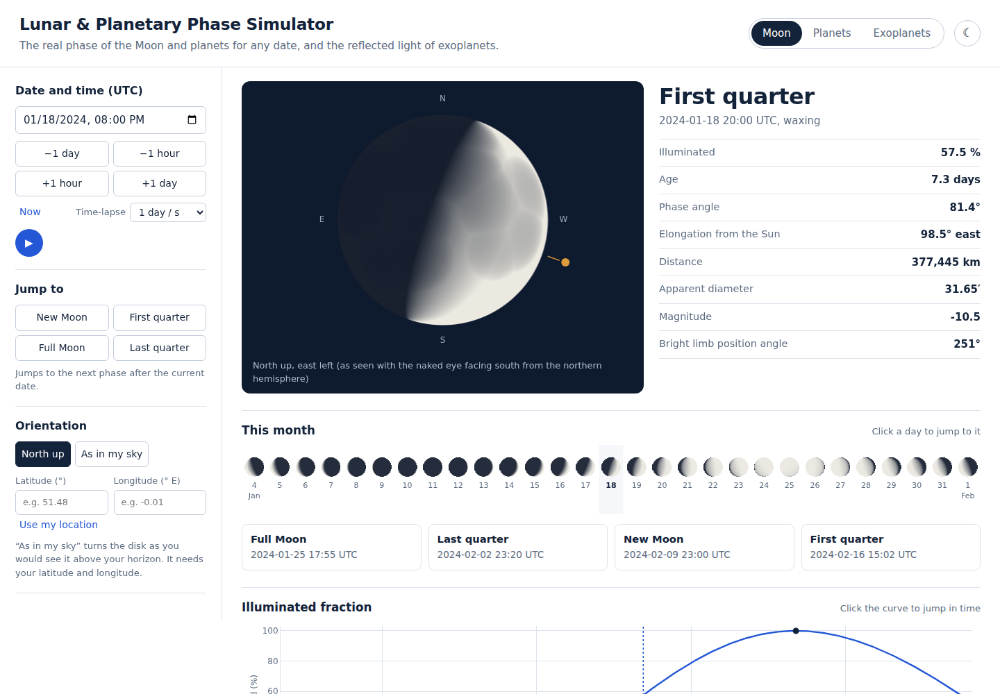
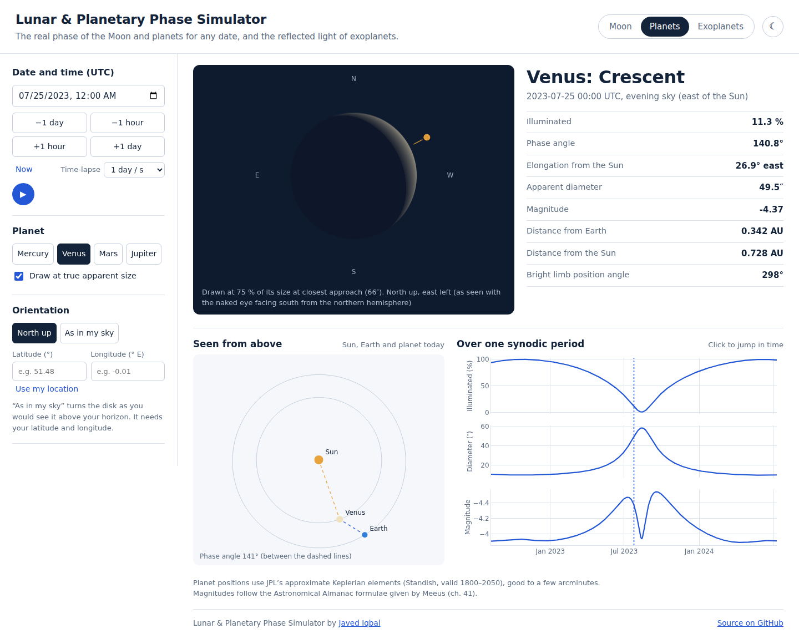
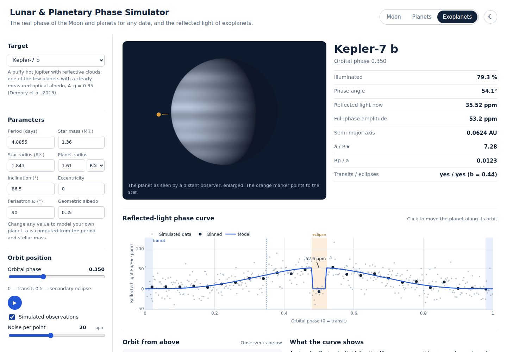

# 🌗 Lunar & Planetary Phase Simulator


**[Open the live simulator →](https://jiqbal-astro.github.io/lunar-planetary-phase-simulator/)**

See the real phase of the Moon and the planets for any date, and model the reflected-light phase curves of exoplanets. Every disk is drawn pixel by pixel from the actual Sun–body–observer geometry.



## Three modes

**Moon:** the phase for any date and time, computed from Meeus’s lunar theory.
- Phase name, illuminated fraction, age, elongation, phase angle, distance, apparent size and magnitude.
- The bright limb points the right way in the sky, either north up or **as seen above your own horizon**. The horizon view uses your latitude and longitude and shows the Moon’s altitude.
- A month strip of daily phases and a list of the next new, quarter and full Moons, both clickable.
- The main maria are drawn at their real positions, and earthshine faintly lights the dark side.

**Planets:** Mercury, Venus, Mars and Jupiter as seen from Earth, from JPL orbital elements.
- Disks drawn at their **true apparent size**, so Venus grows into a huge crescent near inferior conjunction.
- A top-down view of the Sun, Earth and planet, with the phase angle drawn between them.
- Charts over one synodic period of illuminated fraction, apparent diameter and magnitude. These show why Venus is brightest as a crescent, not when full.

**Exoplanets:** reflected-light phase curves, F<sub>p</sub>/F<sub>★</sub> = A<sub>g</sub> (R<sub>p</sub>/r)² Φ(α), in ppm.
- Includes secondary eclipses, transits and eccentric orbits (the changing star–planet distance).
- Presets with sourced parameters: Kepler-7 b (A<sub>g</sub> = 0.35, Demory et al. 2013), HD 209458 b, WASP-12 b, 51 Peg b, Kepler-10 b, GJ 1214 b, K2-18 b and TOI-700 d. Albedos are labelled as measured or assumed.
- Edit any parameter to model your own planet, and add simulated observations with binned data.




## Controls

| | |
|---|---|
| Date and time | Type a UTC date, step ±1 hour or ±1 day, press **Now**, or play a time-lapse (1 hour to 1 week per second). Keys: ← → for days, Shift + ← → for hours, Space to play. |
| Jump | Next new Moon, first quarter, full Moon or last quarter, or click a day in the month strip, an upcoming phase or any chart. |
| Orientation | **North up**, or **As in my sky**, which uses your latitude and longitude (typed or via *Use my location*). |
| Exoplanets | Choose a preset or edit the period, stellar mass and radius, planet radius (R⊕ or R♃), inclination, eccentricity, ω and albedo. Drag or play the orbital phase, or click the curve. |

## Accuracy

The tests check the simulator against published events:

| Event | Check |
|---|---|
| 2024 new, quarter and full Moons | Times found to within 20 minutes; illuminated fraction 0 %, 50 % and 100 % |
| Moon perigee, 13 January 2024 | Distance 362,267 km to within 400 km |
| Venus inferior conjunction, 13 August 2023 | Under 1 % lit, over 55″ across |
| Venus greatest elongation, 4 June 2023 | Elongation 45.4°, half lit, evening sky |
| Mars opposition, 8 December 2022 | Full, 17″, magnitude −1.9 |
| Jupiter opposition, 3 November 2023 | Magnitude −2.9, 49.5″ |
| Rendered disks | Lit area equals the illuminated fraction for every phase and orientation |

## Run it locally

No installation or build is needed. Clone the repository and open `index.html` in a browser:

```bash
git clone https://github.com/Jiqbal-astro/lunar-planetary-phase-simulator.git
cd lunar-planetary-phase-simulator
open index.html          # macOS; or double-click the file
```

## Tests

```bash
node --test                        # 19 astronomy and physics tests
npm install && pip install playwright && python -m playwright install chromium
python tests/test_browser.py       # 55 end-to-end checks in a real browser
```

The browser test presses every button and edits every field. It moves the time controls, jumps to each phase, clicks the month strip, the upcoming phases and every chart, and switches orientation with valid and invalid locations. It also loads every planet and exoplanet preset, checks for JavaScript errors, and confirms that an evening crescent seen from London is lit towards the setting Sun. GitHub Actions runs both suites on every push.

## Project structure

```
├── index.html
├── css/style.css
├── js/
│   ├── astro.js     # Sun, Moon and planet positions, phases, sky orientation (no DOM)
│   ├── phase.js     # shading, exoplanet orbits, reflected light, presets (no DOM)
│   └── app.js       # interface and rendering
├── tests/           # Node tests (physics) and Playwright tests (interface)
├── tools/           # test harness, screenshots, single-file build
└── docs/            # screenshots
```

## Limitations

- Positions are accurate to arcminutes, which is ideal for phases, but they are not suitable for occultation or eclipse timing.
- Libration and the Moon’s axis tilt are ignored when placing the maria.
- Saturn is omitted because its rings need their own geometry.
- Exoplanets are modelled as Lambert spheres in reflected light only. Thermal emission, which dominates for ultra-hot Jupiters in the infrared, and cloud asymmetries are not included.

## References

- Meeus, J. (1998), *Astronomical Algorithms*, 2nd ed., Willmann-Bell (ch. 12, 25, 41, 47–49)
- Standish, E. M., *Keplerian Elements for Approximate Positions of the Major Planets*, JPL Solar System Dynamics
- Winn, J. N. (2010), *Transits and Occultations*, arXiv:1001.2010
- Demory, B.-O. et al. (2013), ApJL, 776, L25 (Kepler-7 b)
- Rowe, J. F. et al. (2008), ApJ, 689, 1345 (HD 209458 b); Bell, T. J. et al. (2017), ApJL, 847, L2 (WASP-12 b); Martins, J. H. C. et al. (2015), A&A, 576, A134 (51 Peg b)

## Author

**Javed Iqbal**: astronomy researcher working on exoplanets and variable stars
[GitHub](https://github.com/Jiqbal-astro) · [Website](https://jiqbal-astro.github.io) · [LinkedIn](https://www.linkedin.com/in/jiqbal-astro/)

Released under the [MIT License](LICENSE).
